# gphotos-cleanup — diagrams

Part 1 is a set of simple whiteboard diagrams. Part 2 has the detailed ones, with
real class, method and file names.

Every diagram is Mermaid. GitHub renders Mermaid. VS Code needs the "Markdown Preview
Mermaid Support" extension. draw.io can import one with Arrange → Insert → Advanced → Mermaid.

---

# Part 1 — Simple (whiteboard versions)

## S1. The whole idea in one line

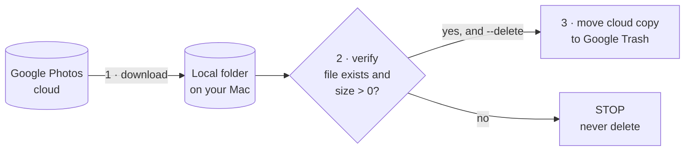

> Talking point: the tool drives a **real Chrome window** the way a human would. It doesn't
> use a Google API. It clicks, presses Shift+D and scrolls.

## S2. The five files and their jobs

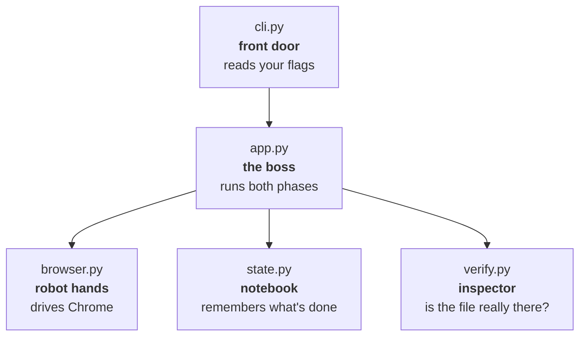

> Talking point: Only browser.py knows that Google Photos exists. If Google changes its web UI, browser.py is the only file you have to fix.

## S3. The conveyor belt (how it goes fast)

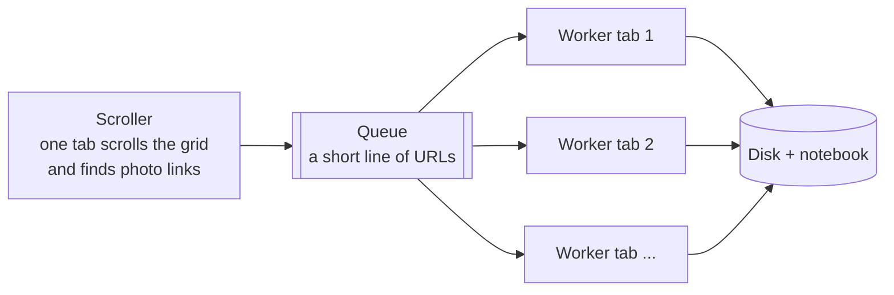

> Talking point: One tab scrolls and finds links while N tabs download at the same time. The queue holds at most 2 × N URLs, so the scroller can't run far ahead of the workers.

## S4. The safety gate

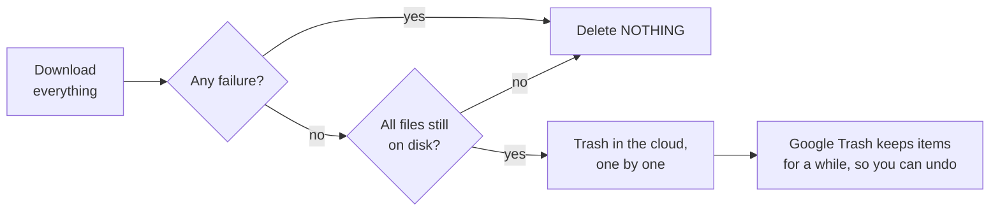

> Talking point: Nothing is deleted unless every download succeeded, and every file is checked on disk again right before deleting. The separate --delete-all mode (D12) skips this gate on purpose.

---

# Part 2 — Detailed

## D1. Modules, external systems and files on disk

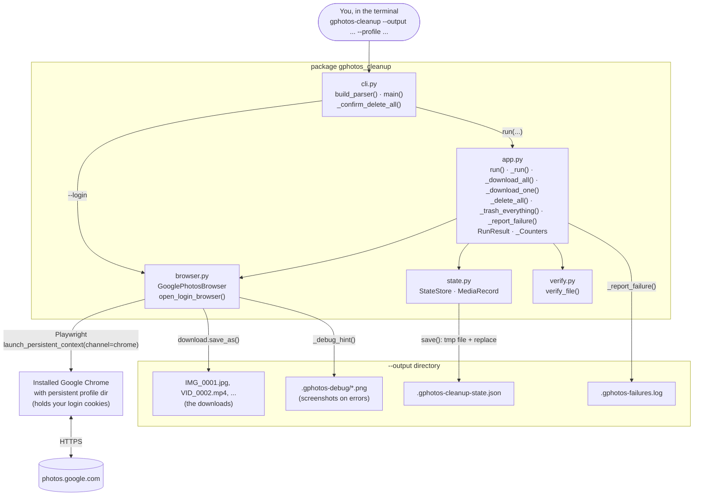

> Talking point: The output folder holds four things: your files, the state notebook, a failure log and debug screenshots. The Chrome profile folder holds the Google login.

## D2. Class diagram

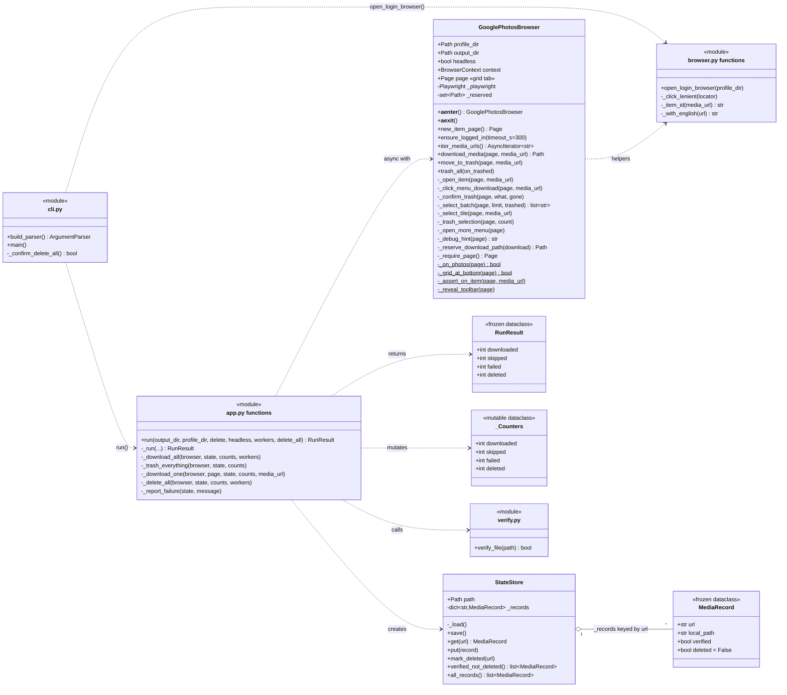

> Talking point: Two classes carry the logic: GooglePhotosBrowser does all the UI automation and StateStore does persistence. MediaRecord is immutable, so a change builds a new record. `$` marks static methods.

## D3. Main flow, from command to summary

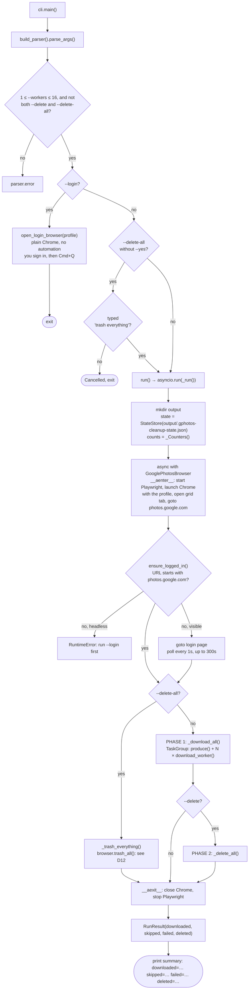

> Talking point: Both phases run inside one browser session: download everything, then optionally delete. --login is a separate mode that opens plain Chrome, because Google blocks sign-in from automated browsers.

## D4. Phase 1 concurrency: producer, queue, workers

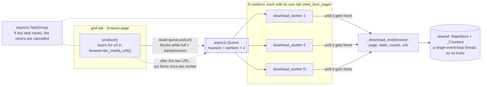

> Talking point: This is the classic producer/consumer pattern on asyncio. None is the stop signal, one per worker. Everything runs on one thread, so the shared state needs no locks.

## D5. Finding photos: `iter_media_urls()` scroll loop

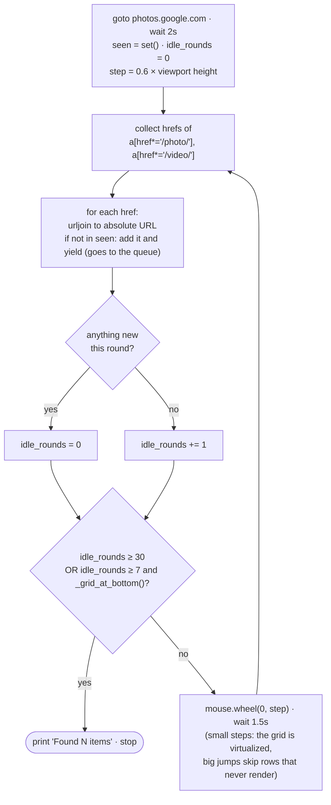

> Talking point: Google's grid is virtualized, so only rows near the screen exist in the HTML. The scroller moves 60% of a screen at a time and stops only after several rounds with nothing new.

## D6. One item: `_download_one()` decisions

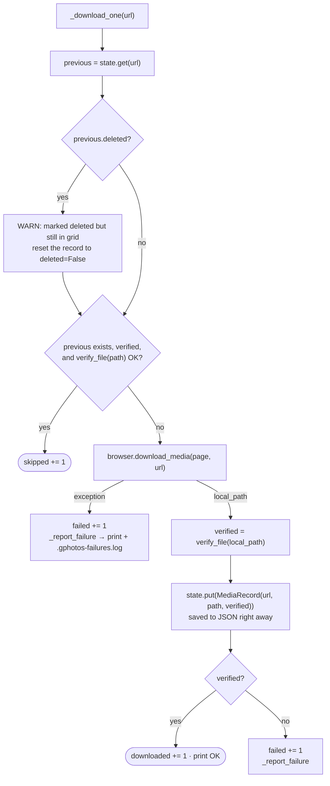

> Talking point: Reruns are cheap because anything already verified on disk is skipped. Each result is written to the JSON right away, so a crash loses at most the items in flight.

## D7. `download_media()` sequence

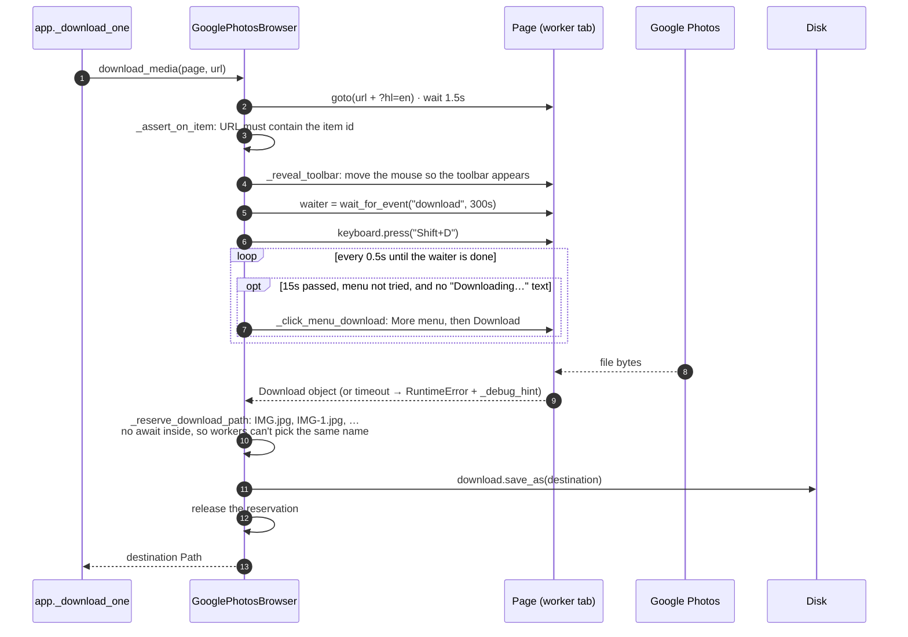

> Talking point: Shift+D is Google Photos' own download shortcut. If no download starts within 15 s and Google isn't showing "Downloading…", the tool tries the More menu once. One waiter covers the whole attempt, so a late download is still caught.

## D8. Phase 2: `_delete_all()`

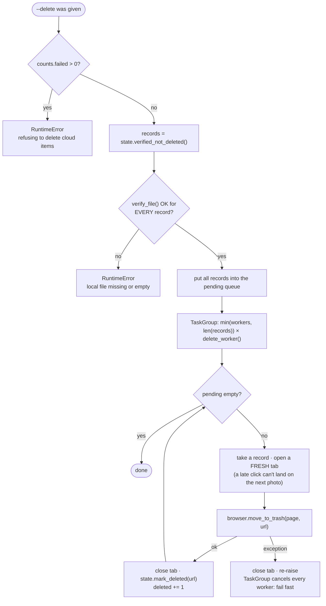

> Talking point: Two gates come before the first deletion: zero failures, and every file still on disk. After that, the first error stops all workers.

## D9. `move_to_trash()` and `_confirm_trash()`

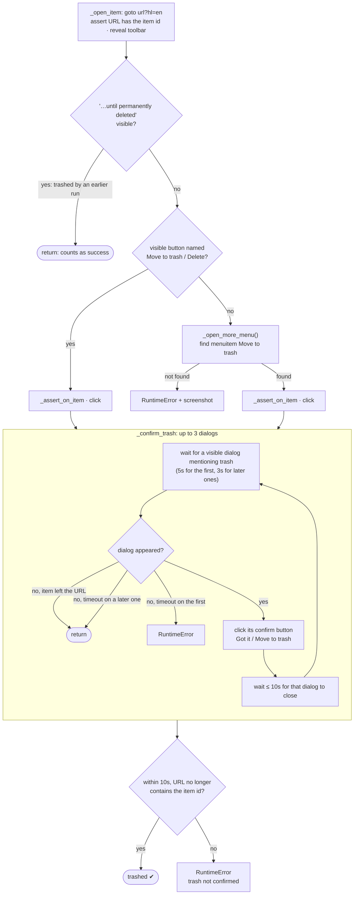

> Talking point: Before every click the tool checks that the tab still shows the right photo. A click returning proves nothing. Success means the viewer has left the photo.

## D10. Life of a `MediaRecord` across runs

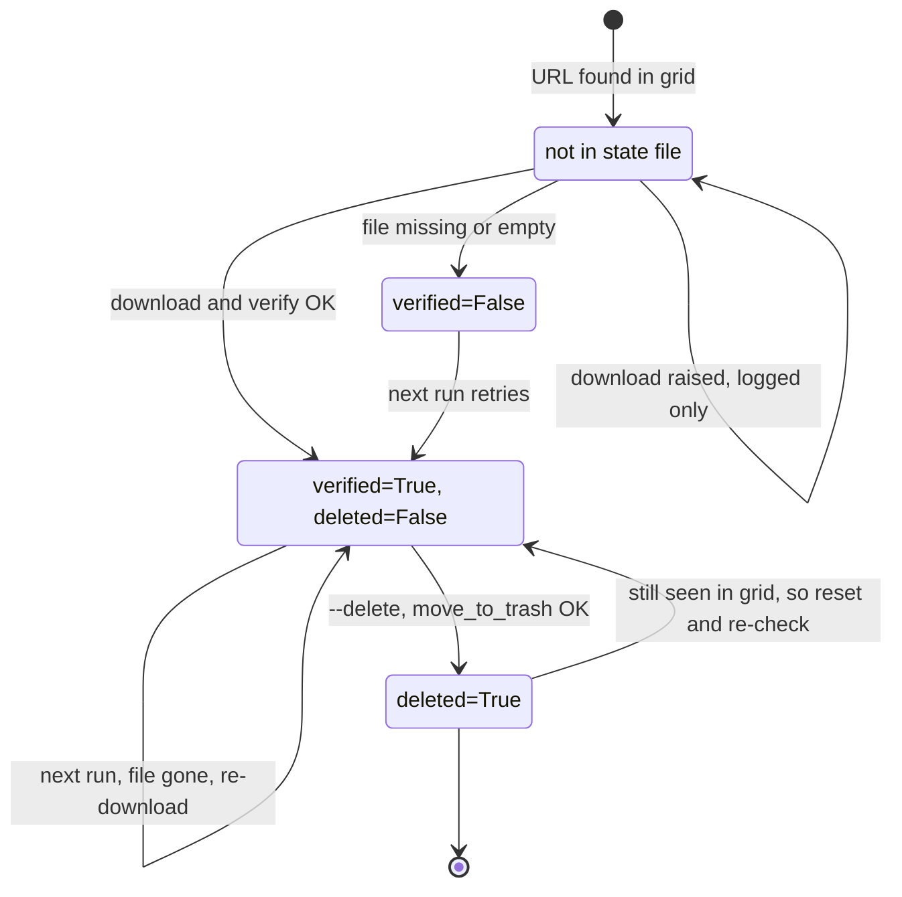

> Talking point: The JSON file is the memory between runs. If a record marked deleted shows up in the grid again, the trash never happened, so the item goes back into the pipeline.

## D11. Safety layers (a good closing slide)

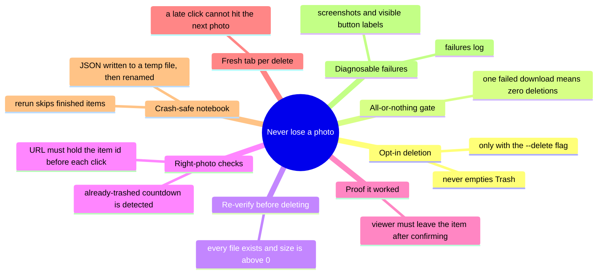

> Talking point: Close the video with this one. Every design choice exists so that no photo is trashed before a good local copy exists.

## D12. `--delete-all`: `trash_all()` in batches from the grid

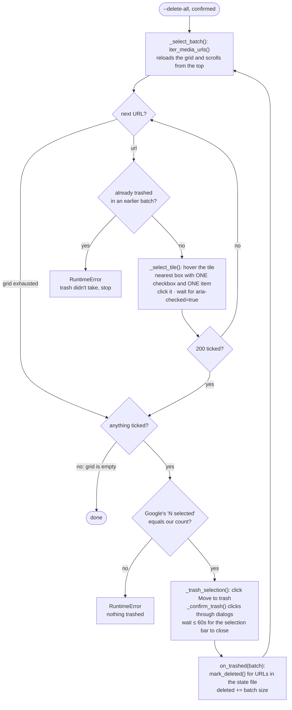

> Talking point: This mode skips every download check on purpose. It ticks items in the grid instead of opening each one, so a batch of 200 costs one trash click. Two checks remain: Google's selected count must match what we ticked, and a photo that shows up again after being trashed stops the run instead of looping forever.
